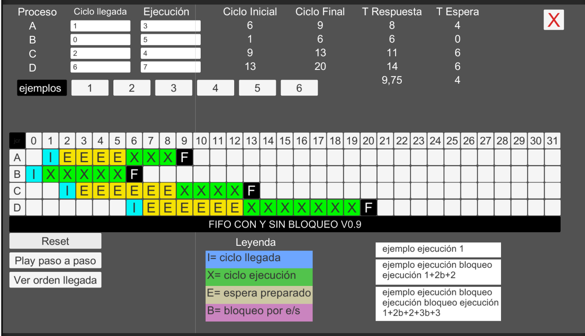

# Simulador del algoritmo FIFO (FCFS) — Unity WebGL

Aplicación interactiva desarrollada en **Unity y C#** para aprender de forma visual cómo funciona el algoritmo de planificación de procesos **FIFO (First In, First Out)**, también conocido como **FCFS (First Come, First Served)**.

Permite introducir procesos propios, utilizar ejemplos preconfigurados y observar, ciclo a ciclo, cómo se organizan la ejecución, la espera y los bloqueos de entrada/salida (E/S).

### 🎮 Probar el simulador

**[Abrir simulador FIFO en el navegador](https://jesuskey787-hash.github.io/Algoritmos-FiFO/)**

No requiere instalación: se ejecuta directamente en el navegador mediante WebGL.

## Vista previa

## Características

- **Datos editables:** define el ciclo de llegada y el tiempo de ejecución de cada proceso.
- **6 ejemplos preconfigurados:** rellena automáticamente los campos para probar distintos escenarios.
- **Ejecución completa (Play):** representa la evolución de los procesos en una línea temporal.
- **Ejecución paso a paso:** avanza **un ciclo por pulsación** para estudiar cada cambio de estado.
- **Orden de llegada:** permite consultar el orden FIFO de los procesos.
- **Procesos con y sin bloqueos:** admite varias fases de CPU alternadas con períodos de E/S.
- **Resultados por proceso:** muestra ciclo inicial, ciclo final, tiempo indicado como «T Respuesta» y tiempo de espera, además de sus medias.
- **Reset:** reinicia la simulación para probar otros valores.

## Cómo utilizarlo

1. Escribe un número en **Ciclo llegada** para indicar cuándo llega cada proceso.
2. En **Ejecución**, introduce los ciclos de CPU que necesita. Puedes incluir bloqueos de E/S siguiendo el formato explicado más abajo.
3. Si prefieres no introducir datos manualmente, pulsa uno de los botones de **ejemplos (1–6)**.
4. Utiliza **Play** para ver la simulación completa o **Play paso a paso** para avanzar ciclo a ciclo.
5. Observa la tabla de estados y los resultados. Utiliza **Ver orden llegada** para consultar el orden de llegada.
6. Pulsa **Reset** para empezar otra simulación.

> Para cambiar del modo de ejecución completa al modo paso a paso, reinicia primero la simulación.

## Formato de los tiempos de ejecución

El simulador permite representar trabajo de CPU y períodos de bloqueo. En los tiempos de ejecución, la letra **`b`** indica un bloqueo de entrada/salida, y el símbolo **`+`** separa las fases.

| Entrada | Significado |
|---|---|
| `3` | 3 ciclos de CPU, sin bloqueo. |
| `1+2b` | 1 ciclo de CPU y después 2 ciclos de bloqueo. |
| `1+2b+2` | 1 ciclo de CPU, 2 de bloqueo y otros 2 de CPU. |
| `3+3b+3+1b+2` | 3 ciclos de CPU, 3 de bloqueo, 3 de CPU, 1 de bloqueo y 2 de CPU. |

## Leyenda de la línea temporal

| Marca | Color | Estado |
|---|---|---|
| **I** | 🟦 Azul/cian | Llegada del proceso. |
| **X** | 🟩 Verde | Proceso en ejecución en la CPU. |
| **E** | 🟨 Amarillo | Proceso esperando su turno en la cola de preparados. |
| **B** | 🟪 Magenta | Proceso bloqueado por entrada/salida. |
| **F** | ⬛ Negro | Finalización del proceso. |

Cada columna de la tabla representa un ciclo y cada fila corresponde a un proceso.

## ¿Cómo funciona FIFO?

FIFO/FCFS asigna la CPU al primer proceso disponible en la cola de preparados. **No es expropiativo**: un proceso mantiene la CPU mientras dura su fase de ejecución, salvo que termine o entre en bloqueo de E/S.

Si un proceso se bloquea, deja libre la CPU. Cuando termina su bloqueo y aún le queda trabajo, vuelve a incorporarse al final de la cola de preparados. Cuando varios procesos llegan en el mismo ciclo, el simulador usa el orden de sus identificadores (A, B, C, D...) como criterio de desempate.

## Resultados mostrados

- **Ciclo inicial:** primer ciclo en el que el proceso comienza a usar la CPU.
- **Ciclo final:** instante en el que completa su ejecución y/o su último bloqueo.
- **T Respuesta:** en esta versión se calcula como `ciclo final - ciclo de llegada` (en terminología habitual de planificación, *tiempo de retorno*).
- **T Espera:** número de ciclos en los que el proceso permanece en espera (`E`).
- **Medias:** promedios de los tiempos calculados para los procesos correspondientes.

## Tecnologías

- **Unity** — motor de desarrollo e interfaz visual.
- **C#** — lógica de simulación y gestión de procesos.
- **WebGL** — ejecución en navegadores web.
- **GitHub Pages** — alojamiento de la versión publicada.

## Objetivo educativo

Facilitar la comprensión de la planificación de procesos en sistemas operativos mediante una herramienta práctica y visual, con ejemplos editables, simulación completa y avance ciclo a ciclo.
